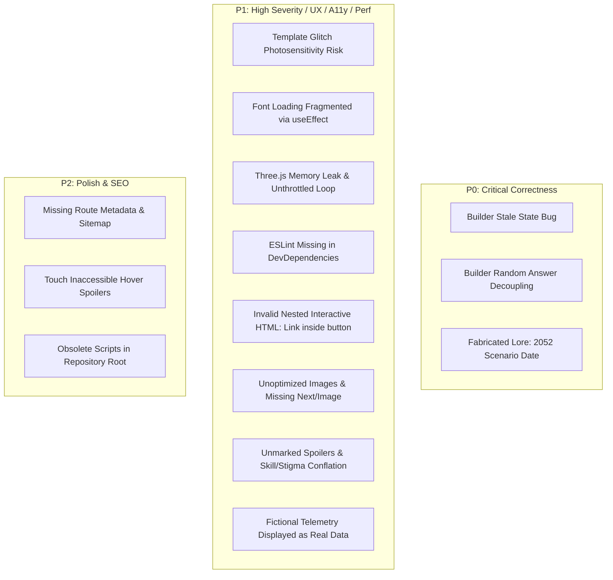

# STAR STREAM // BASELINE AUDIT (PHASE 0)
**Project:** Star Stream (Unofficial Interactive Fan Companion for *Omniscient Reader's Viewpoint*)  
**Repository:** [https://github.com/Ayush20-lex/orv-project](https://github.com/Ayush20-lex/orv-project)  
**Production Site:** [https://orv-project.vercel.app/](https://orv-project.vercel.app/)  
**Audit Date:** October 2026  
**Auditor:** Senior Frontend, Product Designer, Accessibility & QA Specialist  
**Status:** Baseline Completed — Application Code Unmodified  

---

## 1. Executive Summary

Star Stream is an atmospheric web companion for the Korean web novel/manhwa *Omniscient Reader's Viewpoint* (ORV). It delivers a striking initial impression through glowing blue system windows, dark celestial aesthetics, interactive 3D WebGL visuals, and a character stat builder.

However, the baseline audit reveals significant technical debt, correctness flaws, and accessibility risks beneath the visual surface:
1. **Critical Builder Logic Defect (P0):** A React asynchronous state bug in `app/builder/page.tsx` discards the player's final quiz answer, while result stats, modifiers, and sponsors are randomly generated rather than derived from player choices.
2. **Canon & Content Accuracy Issues (P0/P1):** The homepage features an erroneous scenario date (*"In 2052..."* instead of the canon modern-day setting), unverified/paraphrased quotations presented as authentic text, conflation of innate skills with sponsor stigmas, and unmarked late-story spoilers (e.g. *Demon King of Salvation*, *Director of the False Last Act*).
3. **Accessibility & Photosensitivity Hazards (P1):** `app/template.tsx` applies an intense full-screen brightness/hue-rotate strobe on every route transition with zero `prefers-reduced-motion` protection. Fonts (`Orbitron`, `Inter`, `JetBrains Mono`) are injected into the DOM via `useEffect` in only one component, causing font flash/absence on direct route visits. Modals lack focus traps and ARIA attributes, and interactive buttons are illegally nested within Next.js `Link` tags.
4. **WebGL & Memory Lifecycle Risks (P1):** `components/star-orb.jsx` runs an uncapped `requestAnimationFrame` render loop even when scrolled off-screen or backgrounded, while leaking geometries and materials on unmount.
5. **Tooling & Build Inconsistencies (P1):** `npm run lint` fails due to `eslint` not being installed, while `next.config.mjs` sets `ignoreBuildErrors: true` and `unoptimized: true`, suppressing TypeScript compilation checks and image optimization.

---

## 2. Verified Environment & Build/Lint Baselines

All tests below were executed directly against the local repository in `kim_project`:

| Check / Command | Result | Details / Actual Output |
| :--- | :--- | :--- |
| **Lint (`npm run lint`)** | **FAILED (Code 1)** | `eslint: command not found`. `package.json` contains `"lint": "eslint ."`, but neither `eslint` nor any ESLint config/dependencies are installed in `devDependencies`. |
| **Production Build (`next build`)** | **PASSED WITH WARNINGS (Code 0)** | Compiled in 4.8s with Next.js 16.2.6 (Turbopack).<br>• Warning: `⚠ metadataBase property in metadata export is not set for resolving social open graph or twitter images, using "http://localhost:3000"`.<br>• `Skipping validation of types` because `next.config.mjs` has `typescript.ignoreBuildErrors: true`. |
| **Type Check (`tsc --noEmit`)** | **PASSED (Code 0)** | Zero strict TS syntax errors on current TS files, but `tsconfig.json` has `allowJs: true` and multiple `.jsx` components bypass type checking using `/* @ts-ignore */`. |
| **Git Working Tree** | **CLEAN** | Branch: `main` (commit `4431c91`), tracking `origin/main`. No uncommitted local edits were present or modified. |

---

## 3. Route Inventory & Architecture Topology

### 3.1 Active Routes

| Route | Primary Component | Rendering Mode | Purpose & Features |
| :--- | :--- | :--- | :--- |
| `/` | `app/page.tsx` -> `components/star-stream-landing.jsx` | Static (`○`) | Main landing page: Starfield background, Hero section, Star Stream active broadcast, Protagonist overview, Companions preview, Quotes preview, floating Scenario widget, System Window modal. |
| `/characters` | `app/characters/page.tsx` | Static (`○`) | "Dramatis Personae": 9-character grid with hover effects and detailed modal dialog showing stats, skills, modifier, and description. |
| `/constellations` | `app/constellations/page.tsx` | Static (`○`) | "The Night Sky": 4 featured constellations (Secretive Plotter, Uriel, Black Flame Dragon, Sun Wukong) with broadcast log cards and hover-to-reveal true names. |
| `/quotes` | `app/quotes/page.tsx` | Static (`○`) | "Words from the Stream": 8 quote cards with color-coded auras and character attributions. |
| `/builder` | `app/builder/page.tsx` | Static (`○`) | "Incarnation Registration": 3-question personality assessment generating a custom Stat Card exported as PNG via `html-to-image`. |
| `/_not-found` | Next.js default / custom | Static (`○`) | 404 handler. |
| `/icon.svg` | `app/icon.svg` | Static (`○`) | App favicon route rendering `[ ]` branding. |

### 3.2 Layout & Global Wrappers

- **`app/layout.tsx`**: Defines root metadata, viewport, Google Analytics (Vercel), and mounts global `<Navigation />`. Contains invalid OpenGraph URL (`https://star-stream.vercel.app`) and references a non-existent `/favicon.ico`. Does not load fonts.
- **`app/template.tsx`**: Wraps all page transitions with a Framer Motion glitch/strobe animation.
- **`app/loading.tsx`**: In-universe Dokkaebi system synchronization spinner for React Suspense boundaries.
- **`components/navigation.jsx`**: Sticky desktop and mobile slide-out navigation bar with active route glow indicator.

---

## 4. Prioritized Audit Findings

Issues are categorized by severity:
- **P0 — Critical Correctness:** Bugs that break core functionality, corrupt user data, or deliver glaring factual errors.
- **P1 — High Severity / UX & Technical:** Accessibility violations, performance bottlenecks, unhandled lifecycles, and architectural debt.
- **P2 — Medium / Enhancement:** SEO omissions, progressive enhancements, and polish opportunities.



---

### Category A: Correctness, Builder Logic & Data Integrity

#### [P0-1] Stale-State Race Condition in Incarnation Builder
- **File:** [app/builder/page.tsx](file:///c:/Users/ayush/OneDrive/Desktop/orv_project/kim_project/app/builder/page.tsx#L83-L118)
- **Problem:** In `handleAnswer`, `setScores((prev) => ...)` is invoked concurrently with `generateStats()`. Because React state updates are asynchronous, `generateStats()` accesses the old, un-updated `scores` closure.
- **Impact:** The player's answer on the 3rd (final) question is completely omitted from the final stat tallies (`scores.str`, `scores.agi`, `scores.end`, `scores.mana`) and dominant tone calculation.
- **Remediation:** Calculate the updated score object synchronously, pass it directly to `generateStats(updatedScores)`, and derive the result deterministically.

#### [P0-2] Random Selection Completely Decoupled from Quiz Choices
- **File:** [app/builder/page.tsx](file:///c:/Users/ayush/OneDrive/Desktop/orv_project/kim_project/app/builder/page.tsx#L105-L117)
- **Problem:** Modifiers, sponsors, attributes, and skills are selected via `Math.random()` from static arrays:
  ```javascript
  const randomItem = (arr) => arr[Math.floor(Math.random() * arr.length)];
  modifier: randomItem(MODIFIERS),
  sponsor: randomItem(SPONSORS),
  ```
- **Impact:** Player answers have zero influence over their resulting sponsor, modifier, or archetype. An incarnation who chooses ruthless, combat-heavy options can be randomly given an intellectual/interpretive sponsor and skills.
- **Remediation:** Implement an intentional archetype mapping table (e.g., Vanguard/Blood, Strategist/Icy, Sovereign/Gold) with tie-breaking rules so results feel rewarding, personalized, and explainable.

#### [P1-1] Builder Restart Leaves Stale Result State
- **File:** [app/builder/page.tsx](file:///c:/Users/ayush/OneDrive/Desktop/orv_project/kim_project/app/builder/page.tsx#L233)
- **Problem:** "Start Over" resets `step`, `name`, and `scores`, but leaves `result` intact.
- **Impact:** If the user re-enters the flow, transient state anomalies can occur.
- **Remediation:** Reset `result` to `null` in the restart handler.

#### [P1-2] Silent Failure on Image Generation
- **File:** [app/builder/page.tsx](file:///c:/Users/ayush/OneDrive/Desktop/orv_project/kim_project/app/builder/page.tsx#L129)
- **Problem:** `downloadImage` catches export failures with only `console.error("Oops, something went wrong!", err)`.
- **Impact:** If `html-to-image` fails (e.g. cross-origin canvas taint or unsupported SVG filters on mobile Safari), the user is given no visual feedback or retry guidance.
- **Remediation:** Add download state (`isDownloading`, `downloadError`), visual feedback, and fallback export options.

---

### Category B: Canon Authenticity, Quotes & Telemetry Truth

#### [P0-3] Fabricated Scenario Date on Homepage
- **File:** [components/home/star-stream-section.jsx](file:///c:/Users/ayush/OneDrive/Desktop/orv_project/kim_project/components/home/star-stream-section.jsx#L44)
- **Problem:** Text reads: *"In 2052, humanity was forcibly incorporated into a survival scenario."*
- **Canon Context:** In the novel and webtoon, the apocalypse commences in contemporary Seoul (circa 2018), exactly when 28-year-old Mino Soft contractor Kim Dokja finishes reading the final chapter of *Ways of Survival* on subway Line 3 at 7:00 PM. The year 2052 is completely fabricated.
- **Remediation:** Correct the timeline to align with canonical lore or characterize the transition as the sudden arrival of the Dokkaebi Bihyung in contemporary Seoul.

#### [P1-3] Conflation of Innate Skills and Constellation Stigmas
- **File:** [app/characters/page.tsx](file:///c:/Users/ayush/OneDrive/Desktop/orv_project/kim_project/app/characters/page.tsx#L28-L142)
- **Problem:** Multiple characters have their exclusive skills erroneously listed as Stigmas:
  - Kim Dokja: Stigma lists *"Bookmark, Omniscient Reader's Viewpoint"*. In canon, these are his exclusive skills; he begins without a sponsor and receives no stigmas early on.
  - Han Sooyoung: Stigma lists *"Avatar"*. *Avatar* is her exclusive skill; her sponsor (Abyssal Black Flame Dragon) grants stigmas like *Black Flame*.
  - Lee Gilyoung: Stigma lists *"Communication with Insects"*. That is an exclusive skill.
- **Remediation:** Separate Skills from Stigmas according to the canonical Star Stream system rules and attribute stigmas to the proper constellation sponsors.

#### [P1-4] Unmarked Major Spoilers Across Character and Constellation Profiles
- **Files:** [app/characters/page.tsx](file:///c:/Users/ayush/OneDrive/Desktop/orv_project/kim_project/app/characters/page.tsx), [app/constellations/page.tsx](file:///c:/Users/ayush/OneDrive/Desktop/orv_project/kim_project/app/constellations/page.tsx)
- **Problem:** Profiles expose late-novel/epilogue plot developments without warning:
  - Kim Dokja is immediately labeled with the modifier `[Demon King of Salvation]` (acquired much later in the Demon Realm arc).
  - Han Sooyoung is labeled `[Director of the False Last Act]` (novel finale/epilogue reveal).
  - Secretive Plotter's nature is hinted without spoiler granularity.
- **Remediation:** Introduce a structured content model supporting spoiler tags and a global or local spoiler filter (e.g. "Early Scenarios / Manhwa Current / Novel Complete").

#### [P1-5] Unverified & Paraphrased Quotes Presented as Canon
- **Files:** [components/home/shared.js](file:///c:/Users/ayush/OneDrive/Desktop/orv_project/kim_project/components/home/shared.js#L45-L69), [app/quotes/page.tsx](file:///c:/Users/ayush/OneDrive/Desktop/orv_project/kim_project/app/quotes/page.tsx#L18-L59)
- **Problem:** Several quotes are fan-created aphorisms or promotional taglines presented as canonical novel dialogue:
  - *"The person who read the story is now living inside it. The ending? Only he knows."* (Promotional line, not novel dialogue).
  - *"Don't close your eyes. The moment you do, someone dies."* (Attributed to "System Warning — Main Scenario #1", whereas the canonical system window only lists objectives, time limit, and penalty).
  - *"There are 1,863 regressions in this story. This is the one that matters."* (Fan synthesis).
  - *"A constellation's power comes from being remembered. A reader's power comes from remembering."* (Fan aphorism).
- **Remediation:** Clearly label quotes by verification status (`verified_canon`, `paraphrase`, `fan_interpretation`), cite specific chapter numbers for verified quotes, and remove or flag unverified entries.

#### [P1-6] Simulated Telemetry Lacks Lore Disclaimers
- **Files:** [components/home/hero-section.jsx](file:///c:/Users/ayush/OneDrive/Desktop/orv_project/kim_project/components/home/hero-section.jsx#L118), [components/home/star-stream-section.jsx](file:///c:/Users/ayush/OneDrive/Desktop/orv_project/kim_project/components/home/star-stream-section.jsx#L47-L60)
- **Problem:** Counters such as *"1,204 constellations watching"*, *"Active Scenarios: 1,647"*, and *"Coins Circulating: 88,451"* appear without context.
- **Impact:** New visitors cannot distinguish between live website usage metrics and simulated in-universe flavor.
- **Remediation:** Add clear visual and textual framing indicating these are simulated Star Stream channel broadcasts.

---

### Category C: Accessibility, Motion Safety & UI Semantics

#### [P1-7] Severe Photosensitivity Hazard in Page Template
- **File:** [app/template.tsx](file:///c:/Users/ayush/OneDrive/Desktop/orv_project/kim_project/app/template.tsx#L10-L36)
- **Problem:** On every client navigation, `template.tsx` applies an unmitigated full-screen glitch animation with rapid brightness strobing (`brightness(3)`), contrast jumping, hue rotation, and horizontal jitter:
  ```javascript
  filter: [
    "brightness(3) contrast(1.5) hue-rotate(90deg) blur(2px)",
    "brightness(1.5) contrast(1.2) hue-rotate(-20deg) blur(0px)",
    "brightness(2) contrast(1.5) hue-rotate(40deg) blur(1px)",
    "brightness(1) contrast(1) hue-rotate(0deg) blur(0px)",
    "none"
  ]
  ```
- **Accessibility Impact:** Violates WCAG 2.2 Success Criterion 2.3.1 (Three Flashes or Below Threshold). Can trigger seizures or severe nausea for photosensitive users. Completely ignores `prefers-reduced-motion`.
- **Remediation:** Wrap animation triggers in `prefers-reduced-motion` checks, soften the transition to a subtle opacity/drift effect, and remove high-frequency brightness flashes.

#### [P1-8] Fragmented & Unstable Font Loading
- **Files:** [components/star-stream-landing.jsx](file:///c:/Users/ayush/OneDrive/Desktop/orv_project/kim_project/components/star-stream-landing.jsx#L19-L30), [app/characters/page.tsx](file:///c:/Users/ayush/OneDrive/Desktop/orv_project/kim_project/app/characters/page.tsx#L17), [app/constellations/page.tsx](file:///c:/Users/ayush/OneDrive/Desktop/orv_project/kim_project/app/constellations/page.tsx#L15)
- **Problem:** `Orbitron`, `Inter`, and `JetBrains Mono` are dynamically injected into `<head>` only when `StarStreamLanding` mounts on the client.
- **Impact:** 
  1. Direct visits to `/characters`, `/constellations`, `/quotes`, or `/builder` do NOT trigger this injection, resulting in unstyled browser default serif/sans fonts.
  2. `app/characters/page.tsx` and `app/constellations/page.tsx` specify `fontFamily: "Outfit, sans-serif"`, but `Outfit` is never loaded anywhere in the project.
  3. Client-side link injection causes layout shifts (CLS) and flash of unstyled text (FOUT).
- **Remediation:** Centralize typography in `app/layout.tsx` using `next/font/google` with CSS variables (`--font-display`, `--font-ui`, `--font-mono`).

#### [P1-9] Invalid Nested Interactive Markup (`<button>` inside `<Link>`)
- **Files:**
  - [components/home/star-stream-section.jsx](file:///c:/Users/ayush/OneDrive/Desktop/orv_project/kim_project/components/home/star-stream-section.jsx#L62-L69)
  - [components/home/protagonist-section.jsx](file:///c:/Users/ayush/OneDrive/Desktop/orv_project/kim_project/components/home/protagonist-section.jsx#L90-L97)
  - [components/home/quotes-section.jsx](file:///c:/Users/ayush/OneDrive/Desktop/orv_project/kim_project/components/home/quotes-section.jsx#L32-L39)
- **Problem:** Code pattern:
  ```jsx
  <Link href="/constellations">
    <button className="...">View Constellations</button>
  </Link>
  ```
- **Accessibility Impact:** An interactive `<button>` nested within an `<a>` element is invalid HTML5 and confuses screen readers, keyboard focus managers, and assistive tech.
- **Remediation:** Style the `<Link>` element directly as a button or use the `asChild` composition pattern.

#### [P1-10] Modal Dialogs Missing Focus Management and ARIA Roles
- **Files:** [components/star-stream-landing.jsx](file:///c:/Users/ayush/OneDrive/Desktop/orv_project/kim_project/components/star-stream-landing.jsx#L216-L299), [app/characters/page.tsx](file:///c:/Users/ayush/OneDrive/Desktop/orv_project/kim_project/app/characters/page.tsx#L211-L299)
- **Problem:** System Window and Character detail modals are rendered into `document.body` via `createPortal`, but:
  - Missing `role="dialog"` and `aria-modal="true"`.
  - Missing `aria-labelledby` or accessible title.
  - No focus trap: pressing Tab cycles focus behind the modal onto the obscured page.
  - No Escape key listener to dismiss the modal.
  - Focus is not restored to the triggering button when the modal closes.
- **Remediation:** Implement standard dialog accessibility primitives (or adopt an accessible dialog pattern) ensuring focus trapping, Escape dismissal, and focus restoration.

#### [P1-11] Mobile Viewport Obstruction by Scenario Tracker
- **File:** [components/star-stream-landing.jsx](file:///c:/Users/ayush/OneDrive/Desktop/orv_project/kim_project/components/star-stream-landing.jsx#L313-L352)
- **Problem:** The floating `<Main Scenario #1>` widget is fixed at `top-24 left-6` with `max-w-xs`.
- **Impact:** On mobile screens (<420px width), it covers the main navigation, hero heading, and content. It is clickable to collapse, but has no `aria-label`, no keyboard focus ring, and obscures content by default.
- **Remediation:** Default to a compact badge on viewports `< 768px`, add an explicit dismiss/minimize toggle with accessible labels, and prevent viewport overflow.

#### [P1-12] Severe Text Contrast Failures (WCAG AA)
- **Files:** [components/home/companions-grid.jsx](file:///c:/Users/ayush/OneDrive/Desktop/orv_project/kim_project/components/home/companions-grid.jsx#L70-L71), [components/home/hero-section.jsx](file:///c:/Users/ayush/OneDrive/Desktop/orv_project/kim_project/components/home/hero-section.jsx#L96)
- **Problem:** Several text elements use muted hex colors like `#4a5164`, `#5c6272`, and 40% alpha tones on dark backgrounds (`#05060a`), yielding contrast ratios as low as 2.3:1 to 3.1:1.
- **Impact:** Violates WCAG AA 4.5:1 requirement for normal body text, making lore descriptions difficult to read for low-vision users.
- **Remediation:** Elevate muted text tokens to at least `#94a3b8` / `#cbd5e1` to guarantee WCAG AA compliance.

#### [P2-1] Touch-Inaccessible Hover Mechanics for Spoiler Data
- **File:** [app/constellations/page.tsx](file:///c:/Users/ayush/OneDrive/Desktop/orv_project/kim_project/app/constellations/page.tsx#L103)
- **Problem:** Constellation True Names are hidden with CSS `blur-md hover:blur-none cursor-help`.
- **Impact:** Touch devices have no `hover` state, rendering true names unrevealable on mobile. Keyboard users cannot tab to reveal them.
- **Remediation:** Make true names interactive button toggles with `aria-expanded` and click/touch handlers.

---

### Category D: Three.js, WebGL & Rendering Performance

#### [P1-13] Unthrottled WebGL Animation Loop & Missing Visibility Handling
- **File:** [components/star-orb.jsx](file:///c:/Users/ayush/OneDrive/Desktop/orv_project/kim_project/components/star-orb.jsx#L108-L131)
- **Problem:** `animate()` executes `requestAnimationFrame` continuously at the display refresh rate (60–120fps) unconditionally.
- **Impact:** Even when the user has scrolled 2,000px past the canvas to the bottom of the page, or when the browser tab is hidden/minimized, the GPU continues computing rotations and issuing WebGL draw calls, causing unnecessary battery drain and thermals on mobile devices.
- **Remediation:** Integrate `IntersectionObserver` to pause rendering when the canvas is off-screen, and listen to `document.addEventListener("visibilitychange")` to pause when the tab is backgrounded.

#### [P1-14] Three.js Resource Memory Leaks on Component Unmount
- **File:** [components/star-orb.jsx](file:///c:/Users/ayush/OneDrive/Desktop/orv_project/kim_project/components/star-orb.jsx#L145-L154)
- **Problem:** The cleanup function only disposes `particleGeo` and `renderer`:
  ```javascript
  particleGeo.dispose();
  renderer.dispose();
  ```
  It fails to dispose:
  - `outer.geometry` and `outer.material`
  - `inner.geometry` and `inner.material`
  - `core.geometry` and `core.material`
  - `halo.geometry` and `halo.material`
  - `particles.material`
- **Impact:** In single-page applications, navigating back and forth between `/` and other routes leaves orphaned WebGL textures and buffers in GPU memory, eventually triggering WebGL context loss.
- **Remediation:** Recursively traverse `scene` or explicitly dispose all mesh geometries and materials on unmount.

#### [P1-15] Redundant Dynamic Imports of Three.js Component
- **Files:** [components/home/hero-section.jsx](file:///c:/Users/ayush/OneDrive/Desktop/orv_project/kim_project/components/home/hero-section.jsx#L6), [components/home/protagonist-section.jsx](file:///c:/Users/ayush/OneDrive/Desktop/orv_project/kim_project/components/home/protagonist-section.jsx#L6), [components/home/companions-grid.jsx](file:///c:/Users/ayush/OneDrive/Desktop/orv_project/kim_project/components/home/companions-grid.jsx#L6), [components/home/quotes-section.jsx](file:///c:/Users/ayush/OneDrive/Desktop/orv_project/kim_project/components/home/quotes-section.jsx#L6)
- **Problem:** Every extracted home section dynamically imports `StarOrbCanvas`, but only `star-stream-section.jsx` actually renders it!
- **Remediation:** Remove unused dynamic imports across the four child components.

---

### Category E: Image Handling, Assets & Next.js Optimization

#### [P1-16] Unoptimized Next.js Image Pipeline
- **Files:** [next.config.mjs](file:///c:/Users/ayush/OneDrive/Desktop/orv_project/kim_project/next.config.mjs#L6-L8), [app/characters/page.tsx](file:///c:/Users/ayush/OneDrive/Desktop/orv_project/kim_project/app/characters/page.tsx#L192), [components/home/protagonist-section.jsx](file:///c:/Users/ayush/OneDrive/Desktop/orv_project/kim_project/components/home/protagonist-section.jsx#L46-L54)
- **Problem:** 
  1. `next.config.mjs` specifies `images: { unoptimized: true }`.
  2. Character cards load uncompressed JPEGs via CSS `background-image: url(...)` without modern format conversion (AVIF/WebP) or `sizes` attributes.
  3. `ProtagonistSection` uses a native `` tag without responsive dimensions.
- **Impact:** Increases initial transfer weight, causes Cumulative Layout Shift (CLS), and misses out on Next.js automatic image optimization.
- **Remediation:** Re-enable Next.js image optimization, migrate to `next/image` with explicit aspect ratios, modern formats, and proper `alt` descriptions.

#### [P1-17] Missing Image Attribution & Permitted-Use Information
- **Directory:** [public/images/](file:///c:/Users/ayush/OneDrive/Desktop/orv_project/kim_project/public/images)
- **Problem:** Character artwork from the official webtoon (illustrated by Sleepy-C / Redice Studio) is stored as loose JPEGs without license metadata, source links, or copyright notices.
- **Remediation:** Include an in-app credit and disclaimer acknowledging the creators (sing N song, Sleepy-C, Redice Studio, Munpia/Webtoon).

---

### Category F: SEO, Metadata, Social Cards & OpenGraph

#### [P1-18] Inaccurate OpenGraph Production URL
- **File:** [app/layout.tsx](file:///c:/Users/ayush/OneDrive/Desktop/orv_project/kim_project/app/layout.tsx#L13)
- **Problem:** `openGraph.url` is set to placeholder `https://star-stream.vercel.app`, whereas the active production deployment is `https://orv-project.vercel.app/`.
- **Impact:** Social sharing links on Discord, Twitter/X, and Facebook point to an invalid or stale domain.
- **Remediation:** Update `metadataBase` and `openGraph.url` to `https://orv-project.vercel.app`.

#### [P1-19] Missing `metadataBase` Property
- **File:** [app/layout.tsx](file:///c:/Users/ayush/OneDrive/Desktop/orv_project/kim_project/app/layout.tsx#L6-L36)
- **Problem:** `metadataBase` is omitted, causing Next.js build warning:
  `⚠ metadataBase property in metadata export is not set for resolving social open graph or twitter images, using "http://localhost:3000"`.
- **Remediation:** Add `metadataBase: new URL('https://orv-project.vercel.app')`.

#### [P1-20] Missing Favicon File
- **File:** [app/layout.tsx](file:///c:/Users/ayush/OneDrive/Desktop/orv_project/kim_project/app/layout.tsx#L33)
- **Problem:** `icons` references `/favicon.ico`, but no `favicon.ico` exists in `public/`.
- **Impact:** Browser requests to `/favicon.ico` return 404s.
- **Remediation:** Generate a proper `favicon.ico` or rely on Next.js native `app/icon.svg`.

#### [P2-2] Missing Per-Route Metadata & Robots/Sitemap
- **Problem:** `/characters`, `/constellations`, `/quotes`, and `/builder` do not export page-specific titles or descriptions. No `robots.txt` or `sitemap.xml` exists.
- **Remediation:** Add route-specific metadata and standard Next.js `sitemap.ts` and `robots.ts`.

---

### Category G: Tooling, Dependencies, Lockfiles & Dead Code

#### [P1-21] Broken Lint Script & Missing ESLint Tooling
- **File:** [package.json](file:///c:/Users/ayush/OneDrive/Desktop/orv_project/kim_project/package.json#L9)
- **Problem:** Running `npm run lint` fails immediately because `eslint` is not installed.
- **Remediation:** Install `eslint` and `eslint-config-next` in `devDependencies`, and add standard lint configuration.

#### [P1-22] Silenced TypeScript Errors in Build Configuration
- **File:** [next.config.mjs](file:///c:/Users/ayush/OneDrive/Desktop/orv_project/kim_project/next.config.mjs#L3-L5)
- **Problem:** `typescript: { ignoreBuildErrors: true }` hides type errors during production builds.
- **Remediation:** Remove `ignoreBuildErrors: true` once all types are validated, ensuring strict build-time safety.

#### [P1-23] Tooling Inconsistency Between npm and pnpm
- **Files:** `package-lock.json`, `pnpm-workspace.yaml`, `package.json`
- **Problem:** Commit `f438dd9` removed `pnpm-lock.yaml` to force npm on Vercel, but left `pnpm-workspace.yaml` (with dummy text) and a `pnpm.overrides` block in `package.json`.
- **Remediation:** Clean up `pnpm-workspace.yaml` and unify on a consistent package management workflow.

---

## 5. Inventory of Obsolete / Transient Files

The following files were identified as obsolete or dead code during the audit:

| File Path | Size | Reason / Usage Assessment | Action Recommendation |
| :--- | :--- | :--- | :--- |
| `overwrite.js` | 15.8 KB | Node.js one-off script used during prior component extraction. Unused by build or runtime. | Stage for removal in Phase 3. |
| `refactor.js` | 3.9 KB | Node.js script used to extract sections into `components/home/`. Unused by build or runtime. | Stage for removal in Phase 3. |
| `components/ui/button.tsx` | 3.2 KB | Unused shadcn/base-ui button primitive. Zero imports across entire codebase. | Remove or adopt in Phase 2 design system. |
| `pnpm-workspace.yaml` | 81 B | Leftover file containing unconfigured placeholder text (`msw: set this to true or false`). | Remove in Phase 3. |
| `public/placeholder*` | ~7 KB | Unused placeholder assets (`placeholder-logo.png`, `placeholder-user.jpg`, etc.). | Clean up in Phase 3. |

*Note: Per Phase 0 rules, no files have been deleted at this stage.*

---

## 6. Audit Summary Matrix

| ID | Category | Component / File | Severity | Impact Summary |
| :--- | :--- | :--- | :---: | :--- |
| **P0-1** | Correctness | `app/builder/page.tsx` | **P0** | Asynchronous race condition discards 3rd quiz answer from stats. |
| **P0-2** | Correctness | `app/builder/page.tsx` | **P0** | Modifiers, sponsors, and skills are chosen at random rather than from quiz scores. |
| **P0-3** | Canon | `components/home/star-stream-section.jsx` | **P0** | Fabricated "2052" scenario start year contradicts canon modern Seoul setting. |
| **P1-1** | Correctness | `app/builder/page.tsx` | **P1** | Builder restart fails to reset `result` state. |
| **P1-2** | UX | `app/builder/page.tsx` | **P1** | No user-facing error handling when PNG export fails. |
| **P1-3** | Canon | `app/characters/page.tsx` | **P1** | Innate skills (Bookmark, Avatar) mislabeled as sponsor Stigmas. |
| **P1-4** | Canon | `app/characters/page.tsx`, `constellations` | **P1** | Late-story spoilers displayed without warnings or user controls. |
| **P1-5** | Canon | `components/home/shared.js`, `app/quotes` | **P1** | Fan-made slogans presented as verified novel quotes. |
| **P1-6** | Lore/Trust | `components/home/star-stream-section.jsx` | **P1** | Fictional scenario/constellation counters lack in-universe simulation labels. |
| **P1-7** | A11y / Safety | `app/template.tsx` | **P1** | Glitch flash causes severe photosensitivity risk; ignores reduced-motion. |
| **P1-8** | UX / A11y | `components/star-stream-landing.jsx`, layouts | **P1** | Fonts loaded via client `useEffect`; missing on direct route visits. |
| **P1-9** | A11y / HTML | `components/home/*.jsx` | **P1** | Illegal nested `<button>` inside Next.js `<Link>` elements. |
| **P1-10**| A11y | `components/star-stream-landing.jsx`, modals | **P1** | Modals lack `role="dialog"`, focus traps, and Escape key dismissal. |
| **P1-11**| Responsive | `components/star-stream-landing.jsx` | **P1** | Fixed scenario widget obstructs screen on mobile viewports. |
| **P1-12**| A11y | `components/home/companions-grid.jsx` | **P1** | Text contrast fails WCAG AA 4.5:1 ratio on dark backgrounds. |
| **P1-13**| Performance | `components/star-orb.jsx` | **P1** | Three.js loop runs at full FPS off-screen and in hidden background tabs. |
| **P1-14**| Performance | `components/star-orb.jsx` | **P1** | Geometries and materials leak on unmount. |
| **P1-15**| Code Quality | `components/home/*.jsx` | **P1** | Redundant unused dynamic imports of Three.js component. |
| **P1-16**| Performance | `next.config.mjs`, image usages | **P1** | Next.js image optimization disabled; heavy uncompressed JPEGs. |
| **P1-17**| Compliance | `public/images/` | **P1** | Artwork lacks credits, artist attributions, or copyright disclaimers. |
| **P1-18**| SEO | `app/layout.tsx` | **P1** | OpenGraph URL points to wrong deployment domain. |
| **P1-19**| SEO | `app/layout.tsx` | **P1** | Missing `metadataBase` generates build warning. |
| **P1-20**| SEO | `app/layout.tsx` | **P1** | Referenced `/favicon.ico` does not exist in `/public`. |
| **P1-21**| Tooling | `package.json` | **P1** | `npm run lint` fails due to uninstalled ESLint. |
| **P1-22**| Tooling | `next.config.mjs` | **P1** | `ignoreBuildErrors: true` bypasses type checking in production builds. |
| **P1-23**| Tooling | `pnpm-workspace.yaml` | **P1** | Malformed pnpm workspace file left in repository. |
| **P2-1** | A11y | `app/constellations/page.tsx` | **P2** | Hover-only blur reveal unusable on touch screens. |
| **P2-2** | SEO | App routes | **P2** | Missing individual route metadata, sitemap, and robots.txt. |
