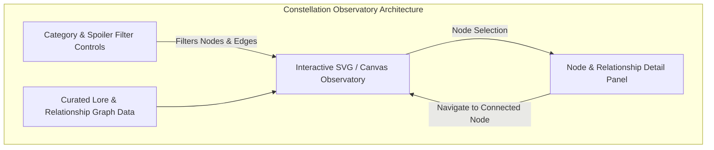

# STAR STREAM // ENGINEERING ROADMAP (PHASES 1–5)
**Project:** Star Stream (Unofficial Interactive Fan Companion for *Omniscient Reader's Viewpoint*)  
**Repository:** [https://github.com/Ayush20-lex/orv-project](https://github.com/Ayush20-lex/orv-project)  
**Production Site:** [https://orv-project.vercel.app/](https://orv-project.vercel.app/)  
**Date:** October 2026  
**Status:** Approved for Phased Execution (Beginning at Phase 1)  

---

## 1. Roadmap Architecture & Execution Philosophy

This roadmap details the progressive transformation of Star Stream from its current prototype state into a production-grade, accessible, spoiler-aware, and lore-trustworthy ORV companion.

### Core Tenets
1. **Never Overwrite What Works:** Refactor iteratively. Preserve the established celestial/cyber-dystopian aesthetic while eliminating technical bugs.
2. **Strict Verification Gates:** No phase will commence until the preceding phase meets all automated lint, build, type, and behavioral check criteria.
3. **Canon Integrity:** All lore, citations, stats, and character relationships must accurately reflect the canon work by sing N song and Redice Studio or be explicitly demarcated as fan synthesis.
4. **Accessible by Design:** Zero seizure/strobe hazards, full WCAG 2.2 AA compliance, keyboard navigation for all interactive controls, and total respect for `prefers-reduced-motion`.


---

## 2. Phase 1 — Correctness, Content Trust & Data Integrity

**Primary Goal:** Fix critical logic errors in the incarnation builder, correct factual inaccuracies, establish maintainable content models with spoiler classification, and restore build tooling.

### 2.1 Tasks & Deliverables

#### 1. Incarnation Builder State Machine & Deterministic Scoring
- **Target File:** `app/builder/page.tsx`
- **Action:**
  - Eliminate the asynchronous state race condition where `generateStats()` reads stale `scores` from the component scope.
  - Implement a pure function `calculateFinalResult(answers, name)` that computes the complete score object synchronously including the final answer before updating state.
  - Replace `Math.random()` selections with an intentional, explainable archetype mapping:
    - **Tone Archetypes:**
      - **Blood (Combatant / Regressor Path):** High STR/END. Sponsors like *Master of Steel*, *Demon-like Judge of Fire*. Modifiers like *[Blade of the Nameless]*, *[Architect of Ruin]*. Skills like *Weapon Mastery*, *Instant Kill*.
      - **Icy (Reader / Strategist Path):** Balanced stats, High Mana/Perception. Sponsors like *Secretive Plotter*, *Independent*. Modifiers like *[Scenario Interpreter]*, *[Reader of Destiny]*. Skills like *Fourth Wall*, *Lie Detection*.
      - **Gold (Nebula Sovereign / Gambler Path):** High Mana/AGI. Sponsors like *Prisoner of the Golden Headband*, *Abyssal Black Flame Dragon*. Modifiers like *[Seeker of the Hidden Truth]*, *[Wanderer of the Forgotten Realm]*. Skills like *Diverse Communication*, *Taming*.
  - Handle ties with deterministic priority (`Icy` -> `Blood` -> `Gold` or secondary stat tie-breakers).
  - Ensure "Start Over" resets all state variables (`step = 0`, `name = ""`, `scores = initialScores`, `result = null`).
  - Add user-facing error handling and visual feedback (`isGenerating`, `downloadError`) around the `html-to-image` export.

#### 2. Canon Content Models & Verification Audit
- **Target Files:** `lib/data/characters.ts`, `lib/data/constellations.ts`, `lib/data/quotes.ts`
- **Content Model Schema:**
  ```typescript
  interface ContentRecord {
    id: string;
    displayName: string;
    description: string;
    canonStatus: 'verified_canon' | 'paraphrase' | 'fan_interpretation';
    chapterCitation?: string;
    spoilerLevel: 'early_scenarios' | 'demon_realm' | 'endgame_novel';
    imageAttribution?: {
      artist: string;
      source: string;
      copyright: string;
    };
  }
  ```
- **Canon Fixes:**
  - **Homepage Scenario Date:** Remove the fabricated "2052" date from `components/home/star-stream-section.jsx`. Replace with canonical framing: contemporary Seoul, Subway Line 3, when Kim Dokja finished chapter 3,149 of *Ways of Survival*.
  - **Character Attributes vs Stigmas:** Separate innate skills (*Bookmark*, *Omniscient Reader's Viewpoint*, *Avatar*, *Communication with Insects*) from constellation stigmas (*Hellfire*, *Ghost Fleet*, *Black Flame*).
  - **Spoiler Flags:** Introduce spoiler boundaries so endgame titles (`[Demon King of Salvation]`, `[Director of the False Last Act]`) are masked by default with user-toggleable reveal buttons.
  - **Quote Verification:** Audit all 8 quotes in `quotes/page.tsx` and 4 on the homepage. Distinguish canonical quotes with chapter numbers (e.g. Chapter 188 for Yoo Joonghyuk's companion quote) from thematic paraphrases.

#### 3. Fictional Telemetry & Lore Labeling
- **Target Files:** `components/home/hero-section.jsx`, `components/home/star-stream-section.jsx`
- **Action:** Clearly label simulated Star Stream metrics (active scenarios, coin circulation, constellation counters) as in-universe simulated broadcast telemetry (`[ Star Stream // Simulated Channel Feed #8612 ]`).

#### 4. Metadata, Favicon & Tooling Baseline
- **Target Files:** `app/layout.tsx`, `package.json`, `README.md`
- **Action:**
  - Set `metadataBase: new URL('https://orv-project.vercel.app')`.
  - Fix OpenGraph URL from `star-stream.vercel.app` to `https://orv-project.vercel.app`.
  - Install `eslint` and `eslint-config-next` in `devDependencies` so `npm run lint` executes and passes.
  - Synchronize `README.md` with Next.js 16 / React 19 documentation.

### 2.2 Phase 1 Validation Gate
- [ ] `npm run lint` passes with 0 errors.
- [ ] `npm run build` succeeds with 0 TypeScript/Next.js warnings (metadataBase warning resolved).
- [ ] Incarnation Builder verified: 3rd question points mathematically reflected in final stat card; archetype mapping confirmed predictable; restart completely clears state; PNG export provides feedback on failure.
- [ ] Homepage "2052" claim eliminated; quote attribution status clearly displayed.

---

## 3. Phase 2 — Design Consistency, UX, and Accessibility

**Primary Goal:** Build a unified design-token system, eliminate accessibility/photosensitivity hazards, standardize typography across all routes, and ensure responsive mobile excellence.

### 3.1 Tasks & Deliverables

#### 1. Centralized Typography & Design Tokens
- **Target Files:** `app/layout.tsx`, `app/globals.css`, `lib/tokens.ts`
- **Action:**
  - Load `Orbitron` (display), `Inter` (UI/body), and `JetBrains Mono` (code/system) globally in `app/layout.tsx` using `next/font/google` with CSS variables `--font-display`, `--font-ui`, `--font-mono`.
  - Delete the client-side `useStarStreamFonts` DOM injector.
  - Replace ad-hoc inline font objects with CSS variable utility classes (`font-display`, `font-ui`, `font-mono`).
  - Standardize color tokens:
    - Celestial Abyss (`--color-abyss: #05070d`)
    - Stream Cyan/Icy (`--color-icy: #82b1ff`)
    - Regressor Crimson (`--color-blood: #ff4d4d`)
    - Golden Constellation (`--color-gold: #ffca28`)
    - System Window Surface (`--color-panel: rgba(10, 18, 36, 0.85)`)
    - Border Glow (`--color-panel-edge: rgba(130, 177, 255, 0.2)`)

#### 2. Photosensitivity Remediation & Motion Safety
- **Target File:** `app/template.tsx`
- **Action:**
  - Remove high-intensity brightness flashes (`brightness(3)`), hue shifts, and horizontal jitter.
  - Implement a tasteful, atmospheric opacity-fade and scale-in transition (duration: 0.25s).
  - Explicitly integrate Framer Motion `useReducedMotion()`. If reduced motion is preferred, disable all filter and translate animations entirely.

#### 3. Semantic HTML & Interactive Markup Cleanup
- **Target Files:** `components/home/*.jsx`, `app/characters/page.tsx`, `components/navigation.jsx`
- **Action:**
  - Eliminate illegal `<button>` nested inside `<Link>` elements.
  - Convert character cards and interactive items from plain clickable `div`s into `<button>` elements or links with proper `role`, `aria-label`, and keyboard activation (Enter/Space).
  - Add `aria-label="Toggle navigation menu"` and `aria-expanded` to mobile hamburger button.
  - Provide meaningful `alt` attributes for all character images.

#### 4. Accessible System Window & Modal Dialog Architecture
- **Target Files:** `components/system-window-modal.tsx`, `components/character-modal.tsx`
- **Action:**
  - Wrap modals in accessible dialog containers with `role="dialog"`, `aria-modal="true"`, and `aria-labelledby`.
  - Implement full keyboard focus trap inside active modals.
  - Add global `Escape` key event listener to close modals.
  - Restore focus to the triggering element when the modal is closed.

#### 5. Mobile Layout & Scenario Tracker Hardening
- **Target Files:** `components/star-stream-landing.jsx`, all page views
- **Action:**
  - Refactor `<Main Scenario #1>` tracker on mobile viewports (<768px) into an unobtrusive floating badge or banner dock that does not block navigation or hero text.
  - Audit and fix WCAG AA contrast on muted text tokens (`#4a5164` -> minimum `#94a3b8`).
  - Replace hover-only blur reveal on Constellation true names with touch-friendly click-to-reveal button toggles.

### 3.2 Phase 2 Validation Gate
- [ ] Lighthouse Accessibility score >= 95.
- [ ] Zero WCAG AA color contrast violations across all 5 routes.
- [ ] Screen reader & keyboard-only testing passes: modals trap focus, Escape closes dialogs, all interactive elements navigable via Tab/Shift+Tab.
- [ ] Reduced motion preference tested: page transitions and starfield motion gracefully disabled.
- [ ] Mobile responsive testing on 360px, 390px, and 768px viewports confirms zero overflow or obstruction.

---

## 4. Phase 3 — Performance, WebGL Lifecycle & Technical Hardening

**Primary Goal:** Eliminate WebGL memory leaks, pause off-screen rendering, optimize imagery, establish Server Component boundaries, and remove dead code.

### 4.1 Tasks & Deliverables

#### 1. Three.js Lifecycle & GPU Optimization
- **Target File:** `components/star-orb.jsx`
- **Action:**
  - Implement `IntersectionObserver` on the canvas container to pause the `requestAnimationFrame` loop when the orb is scrolled out of viewport.
  - Add `document.addEventListener("visibilitychange")` to pause rendering when the browser tab is hidden or minimized.
  - Comprehensive resource disposal on component unmount:
    ```javascript
    outer.geometry.dispose();
    outer.material.dispose();
    inner.geometry.dispose();
    inner.material.dispose();
    core.geometry.dispose();
    core.material.dispose();
    halo.geometry.dispose();
    halo.material.dispose();
    particleGeo.dispose();
    particles.material.dispose();
    renderer.dispose();
    ```
  - Replace `window.addEventListener("resize")` with `ResizeObserver` observing the container element.
  - Remove redundant dynamic imports of `StarOrbCanvas` from `hero-section.jsx`, `protagonist-section.jsx`, `companions-grid.jsx`, and `quotes-section.jsx`.

#### 2. Modern Image Optimization Pipeline
- **Target Files:** `next.config.mjs`, `app/characters/page.tsx`, `components/home/protagonist-section.jsx`
- **Action:**
  - Remove `images: { unoptimized: true }` from `next.config.mjs`.
  - Replace CSS `background-image` and native `` tags with Next.js `<Image>` component (`next/image`).
  - Specify explicit responsive `sizes`, aspect ratios (`3/4`), and `placeholder="blur"` or sleek dark skeleton fallbacks.
  - Ensure priority loading for above-the-fold hero imagery while lazy-loading companion and quote assets.

#### 3. Client vs Server Component Optimization
- **Target Files:** Route pages (`app/characters/page.tsx`, `app/constellations/page.tsx`, `app/quotes/page.tsx`)
- **Action:**
  - Extract interactive modals and filters into lightweight client component leaves (`"use client"`).
  - Convert the top-level route pages into Server Components (`RSC`) for static HTML streaming and zero-JS initial payload where possible.

#### 4. Removal of Obsolete / Transient Code
- **Action:**
  - Verify and safely delete proved dead files:
    - `overwrite.js`
    - `refactor.js`
    - `pnpm-workspace.yaml`
    - Unused placeholder images in `public/`
  - Remove `typescript.ignoreBuildErrors: true` from `next.config.mjs` and verify strict build validation.

### 4.2 Phase 3 Validation Gate
- [ ] Memory leak test: Navigating between `/` and `/characters` 20 times shows stable memory usage without WebGL context loss.
- [ ] Off-screen test: Three.js render loop confirmed idle when scrolled down or when tab is hidden.
- [ ] Next.js Image optimization active: images served as AVIF/WebP with responsive srcset.
- [ ] `next build` passes with strict TypeScript type checking (`ignoreBuildErrors` removed).

---

## 5. Phase 4 — Constellation Observatory (Signature Feature)

**Primary Goal:** Design and build the signature interactive feature: a curated, spoiler-aware relationship observatory mapping the complex bonds, rivalries, sponsorships, and nebulae of the Star Stream.



### 5.1 Architecture & UX Requirements

#### 1. Curated Lore & Relationship Graph Data Model
- **File:** `lib/data/observatory-data.ts`
- **Node Entities:**
  - **Incarnations:** Kim Dokja, Yoo Joonghyuk, Han Sooyoung, Yoo Sangah, Lee Hyunsung, Jung Heewon, Lee Jihye, Lee Gilyoung, Shin Yoosung.
  - **Constellations:** Secretive Plotter, Demon-like Judge of Fire (Uriel), Abyssal Black Flame Dragon, Prisoner of the Golden Headband (Sun Wukong), Maritime War God, Master of Steel.
  - **Dokkaebis & Entities:** Bihyung, The Fourth Wall.
- **Edge Relationship Types:**
  - `sponsor_of` (e.g. Uriel -> Jung Heewon)
  - `companion` / `life_and_death` (e.g. Kim Dokja <-> Yoo Joonghyuk)
  - `plagiarist_and_reader` (e.g. Han Sooyoung <-> Kim Dokja)
  - `disciple_of` (e.g. Lee Jihye -> Yoo Joonghyuk)
  - `contractual` (e.g. Kim Dokja <-> Bihyung)
  - `intrigued_by` / `mysterious_bond` (e.g. Secretive Plotter <-> Kim Dokja)

#### 2. Rendering Implementation (Lightweight SVG / HTML Canvas)
- **Target Route:** `app/observatory/page.tsx`
- **Design Decision:** Prefer a bespoke, performant SVG + Framer Motion interactive graph over bulky third-party WebGL graph engines. This ensures razor-sharp text rendering, perfect CSS styling, responsive scaling, and direct keyboard accessibility.
- **Visual Design:**
  - Nodes styled as celestial star clusters with glowing halo rings color-coded by archetype/nebula.
  - Edges rendered as pulsing starlight constellation lines with interactive relationship badges.
  - Zoom and pan capabilities with smooth inertial damping.
  - Visual distinction between Incarnation nodes (diamond/circle crests) and Constellation nodes (radiant celestial stars).

#### 3. Detail Panel & Traversal Navigation
- **Component:** `components/observatory/node-detail-panel.tsx`
- **Features:**
  - Selecting a node opens a slide-over System Window displaying modifier, true name (spoiler-governed), personal attributes, and active bonds.
  - Clickable connection list: clicking any connected entity smoothly centers and selects that node in the observatory.
  - Verified novel citations and chapter references for each relationship.

#### 4. Spoiler Filtering & Accessibility
- **Controls:**
  - Category filters: *All*, *Incarnations*, *Constellations*, *Kim Dokja's Company*, *Eden / Olympus*.
  - Spoiler slider / toggle:
    - Level 1: *Seoul Dome (Early Scenarios)*
    - Level 2: *Demon Realm & Constellation Banquet*
    - Level 3: *The Final Chapter & Epilogue*
  - Full keyboard accessibility: nodes are focusable in a logical reading order; Enter/Space opens details; Arrow keys navigate between connected nodes.
  - `prefers-reduced-motion` pauses pulse animations and eases transitions.

### 5.2 Phase 4 Validation Gate
- [ ] Observatory renders smoothly on desktop and mobile viewports.
- [ ] Filter controls instantaneously update node/edge visibility without layout jitter.
- [ ] Clicking connections transitions smoothly to connected nodes.
- [ ] Spoiler filtering accurately conceals late-game connections and modifiers.
- [ ] Keyboard navigation fully functional across all nodes and detail panel.

---

## 6. Phase 5 — SEO, Trust, Attribution & Production QA

**Primary Goal:** Finalize production polish, verify social sharing cards, ensure legal and copyright transparency, execute cross-browser QA, and validate deployment.

### 6.1 Tasks & Deliverables

#### 1. Route Metadata, Canonical URLs & Social Sharing
- **Target Files:** All route files, `app/sitemap.ts`, `app/robots.ts`
- **Action:**
  - Dedicated titles and descriptions for every page:
    - `/`: *Star Stream — Omniscient Reader's Viewpoint Fan Companion*
    - `/characters`: *Dramatis Personae — Characters of the Star Stream*
    - `/constellations`: *The Night Sky — Constellations & Sponsors*
    - `/quotes`: *Words from the Stream — Iconic ORV Quotations*
    - `/builder`: *Incarnation Registration — Star Stream Stat Builder*
    - `/observatory`: *Constellation Observatory — Interactive Relationship Map*
  - Proper canonical URL headers (`https://orv-project.vercel.app/...`).
  - Auto-generated `sitemap.xml` and `robots.txt`.

#### 2. Legal Disclaimers & Creator Attribution
- **Target Files:** `components/footer.tsx`, `components/disclaimer-banner.tsx`
- **Action:**
  - Add a concise, professional footer disclaimer on all pages:
    > *"Star Stream is an unofficial, non-commercial fan-created companion project. Omniscient Reader's Viewpoint (전지적 독자 시점) is created by sing N song (싱숑). Webtoon artwork by Sleepy-C / Redice Studio. Published by Munpia and Webtoon. All rights belong to their respective owners."*
  - Provide direct outbound links to the official Webtoon and Munpia releases.

#### 3. Comprehensive End-to-End QA Checklist
- **Cross-Browser Verification:**
  - Chrome / Edge (Chromium)
  - Firefox
  - Safari (iOS & macOS) — verify WebGL canvas rendering, `html-to-image` export, and backdrop-blur support.
- **Viewport Testing:**
  - Mobile: 360px (compact Android), 390px (iPhone 14/15)
  - Tablet: 768px (iPad Mini), 1024px (iPad Pro)
  - Desktop: 1440px, 1920px (Ultra-wide)
- **Functional Verification:**
  - Builder: Quiz -> Stat Card -> Download PNG -> Restart.
  - Characters: Card click -> Modal open -> Tab navigation -> Escape to close.
  - Observatory: Node click -> Details -> Traversal -> Filter toggles.
- **Production Build:**
  - Run full clean `npm run build` and `npm run lint`.
  - Validate bundle sizes and zero console errors.

### 6.2 Phase 5 Validation Gate
- [ ] Production build succeeds with 0 errors and 0 warnings.
- [ ] Social card previews (Twitter card, Discord embed) render correctly with image and production domain.
- [ ] No layout regressions or broken assets across all viewports.
- [ ] Explicit user sign-off obtained before deployment.

---

## 7. Immediate Next Step

Proceed to **PHASE 1: Correctness and Content Trust**:
1. Implement synchronous, deterministic scoring and archetype mapping in `app/builder/page.tsx`.
2. Clean up "Start Over" state and add export feedback.
3. Correct the "2052" scenario start date in `components/home/star-stream-section.jsx`.
4. Establish structured data models for characters, constellations, and quotes with canon verification and spoiler flags.
5. Fix OpenGraph metadata and restore ESLint in `package.json`.
6. Run lint and production build checks, and deliver the Phase 1 Checkpoint Report.
