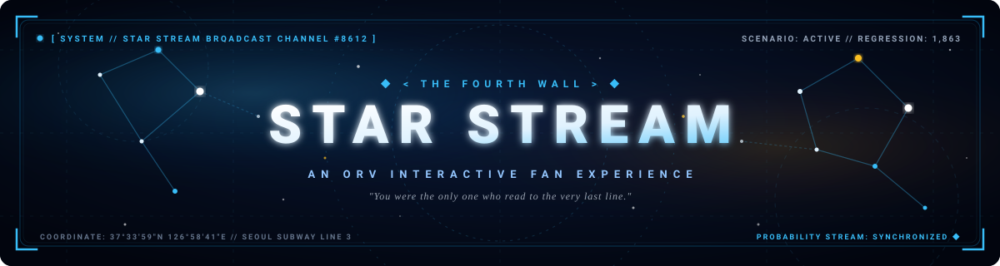
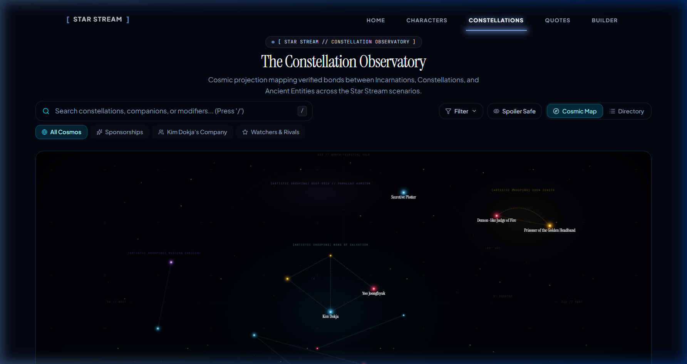

<div align="center">
  <a href="https://orv-project.vercel.app/">
    
  </a>

  <p align="center">
    <i>"You were the only one who read to the very last line."</i>
  </p>

  <p align="center">
    <strong>An immersive, responsive web companion and interactive cosmic lore atlas dedicated to the Korean webnovel and manhwa masterpiece, <em>Omniscient Reader's Viewpoint (전지적 독자 시점)</em>.</strong>
  </p>

  <p align="center">
    <a href="https://orv-project.vercel.app/"></a>
    <a href="https://nextjs.org/"></a>
    <a href="https://react.dev/"></a>
    <a href="https://www.typescriptlang.org/"></a>
    <a href="https://tailwindcss.com/"></a>
    <a href="https://www.framer.com/motion/"></a>
    
  </p>

  <p align="center">
    <a href="#overview">Overview</a> •
    <a href="#features">Core Features</a> •
    <a href="#preview">Live Preview</a> •
    <a href="#technology">Technology</a> •
    <a href="#installation">Installation</a> •
    <a href="#documentation">Documentation</a> •
    <a href="#contributing">Contributing</a> •
    <a href="#disclaimer">Disclaimer</a>
  </p>
</div>

---

<a id="overview"></a>
## 🌌 Overview

Welcome to the **Star Stream**.

When the free service of the world ended on Seoul Subway Line 3, humanity was thrust into the brutal survival scenarios orchestrated by transcendent entities. Built with modern web architecture and styled after the iconic glowing cyan **System Windows**, this project brings the intricate universe of *Omniscient Reader's Viewpoint* to life:

- **Holographic Aesthetics:** Sleek midnight glassmorphism, responsive starfields, and cosmic typography tailored for desktop and mobile reading.
- **Lore-Accurate Systems:** Meticulously cross-referenced character stats, stigmas, exclusive skills, and constellation modifiers matching canonical webnovel lore.
- **Interactive Exploration:** A real-time constellation relationship graph, dynamic quote filter gallery, and an attribute builder with downloadable character cards.

---

<a id="features"></a>
## ✨ Core Features

<table>
  <tr>
    <td width="50%" valign="top">
      <h3>🎭 Dramatis Personae (Character Encyclopedia)</h3>
      <p>A comprehensive visual grid detailing the companions who shape the scenarios. View full dossiers for <strong>Kim Dokja</strong>, <strong>Yoo Joonghyuk</strong>, <strong>Han Sooyoung</strong>, and their allies. Features sponsor bonds, personal attributes, stigmas, exclusive skills, and built-in spoiler protections for late-scenario revelations.</p>
      <p><em>Route: <code>/characters</code></em></p>
    </td>
    <td width="50%" valign="top">
      <h3>🔭 The Night Sky (Constellation Observatory)</h3>
      <p>An interactive celestial atlas mapping verified connections between Incarnations, Constellations, and Ancient Entities. Explore nebulas, filter by alignment (Sponsorships, Kim Dokja's Company, Watchers & Rivals), search with instant keyboard shortcuts (<code>/</code>), and activate <strong>Spoiler Safe Mode</strong>.</p>
      <p><em>Route: <code>/constellations</code></em></p>
    </td>
  </tr>
  <tr>
    <td width="50%" valign="top">
      <h3>📜 Words from the Stream (Memory Archive)</h3>
      <p>A curated gallery preserving the novel's most iconic lines and broadcasts. Features character-adaptive color auras, category filtering, and the ominous <em>True Voice</em> broadcast styling used by ancient beings speaking across the Star Stream.</p>
      <p><em>Route: <code>/quotes</code></em></p>
    </td>
    <td width="50%" valign="top">
      <h3>⚡ Incarnation Attribute Builder</h3>
      <p>Engage in the Dokkaebi's scenario questionnaire to determine your survival disposition. Calculates baseline statistics (STR, AGI, END, MANA), resolves your dominant psychological tone, assigns an archetype modifier, and exports your custom System Window as a high-resolution PNG.</p>
      <p><em>Route: <code>/builder</code></em></p>
    </td>
  </tr>
</table>

---

<a id="preview"></a>
## 🖥️ Live Application Preview

<div align="center">
  <a href="https://orv-project.vercel.app/constellations">
    
  </a>
  <p align="center">
    <em>The interactive Constellation Observatory mapping entity relationships across the Star Stream scenarios.</em>
  </p>
</div>

---

<a id="technology"></a>
## 🛠️ Technology Architecture

Star Stream is engineered with a modern, high-performance web stack designed for fluid animations and instant client-side interactions:

| Layer | Technologies | Purpose |
| :--- | :--- | :--- |
| **Framework** | [Next.js 16.2.6](https://nextjs.org/) (App Router, Turbopack) | Static prerendering of all 10 application routes, dynamic metadata, and sitemap generation. |
| **Core UI** | [React 19](https://react.dev/) & [TypeScript 5.7.3](https://www.typescriptlang.org/) | Strict type safety across lore registries, constellation graphs, and scoring engine. |
| **Styling** | [Tailwind CSS v4](https://tailwindcss.com/) & Vanilla CSS | Custom cosmic dark theme, cyan-blue glows, glassmorphism tokens, and responsive layouts. |
| **Animations** | [Framer Motion 12.42](https://www.framer.com/motion/) | Smooth holographic glitch transitions, layout morphing, modal dialogs, and drawer reveals. |
| **3D Graphics** | [Three.js 0.185](https://threejs.org/) | Interactive 3D celestial star orb canvas rendered on landing interfaces. |
| **Card Export** | [`html-to-image` 1.11](https://github.com/bubkoo/html-to-image) | Client-side DOM rasterization for instant PNG download of generated Incarnation status cards. |
| **Icons & Font** | [Lucide React](https://lucide.dev/) & Google Fonts | Accessible iconography paired with *Space Grotesk*, *Cinzel Decorative*, and *JetBrains Mono*. |
| **Telemetry** | [@vercel/analytics 1.6](https://vercel.com/analytics) | Lightweight, privacy-conscious production performance and page analytics. |

---

<a id="installation"></a>
## 🚀 Local Installation

Run the Star Stream locally in four straightforward steps:

### 1. Clone the repository
```bash
git clone https://github.com/Ayush20-lex/orv-project.git
cd orv-project
```

### 2. Install dependencies
```bash
# Using npm
npm install

# Or using bun
bun install
```

### 3. Start the development server
```bash
# Using npm
npm run dev

# Or using bun
bun run dev
```

### 4. Open the application
Navigate to [http://localhost:3000](http://localhost:3000) in your browser. The Star Stream will initialize automatically.

### Available Scripts
- `npm run dev` / `bun run dev` — Launch local development server with Turbopack.
- `npm run build` / `bun run build` — Compile optimized production bundle (prerenders all 10 static pages).
- `npm run start` / `bun run start` — Run production server locally.
- `npm run lint` / `bun run lint` — Execute ESLint 9 checks across all source files.

---

<a id="documentation"></a>
## 📚 Project History & Documentation

Historical milestone audits, architectural analyses, and quality-assurance reports are cataloged in the repository:

- 📋 [Documentation Inventory & Mapping](MARKDOWN_DOCUMENTATION_INVENTORY.md) — Categorized reference of all 26 repository documents.
- 🧹 [Dead Code Cleanup Report](DEAD_CODE_CLEANUP_REPORT.md) — Comprehensive record of pruned assets, dead code, and space optimization.
- 🛡️ [Final Cleanup Verification Review](CLEANUP_FINAL_REVIEW.md) — Pre-merge test proofs, lockfile audit, and validation results.

<details>
  <summary><strong>📁 Expand Historical Phase Reports (23 Archived Documents)</strong></summary>

  <br />

  | Phase & Focus | Key Reports |
  | :--- | :--- |
  | **Phase 1: Canon Correctness** | • [`PHASE_1_CANON_SIGNOFF.md`](docs/archive/phase-reports/PHASE_1_CANON_SIGNOFF.md)<br>• [`PHASE_1_VERIFICATION_REPORT.md`](docs/archive/phase-reports/PHASE_1_VERIFICATION_REPORT.md)<br>• [`PHASE_1_FINAL_REVIEW.md`](docs/archive/phase-reports/PHASE_1_FINAL_REVIEW.md)<br>• [`PHASE_1_FINAL_DATA_FIX_REPORT.md`](docs/archive/phase-reports/PHASE_1_FINAL_DATA_FIX_REPORT.md) |
  | **Phase 2: Accessibility & W3C APG** | • [`PHASE_2_ACCESSIBILITY_SIGNOFF.md`](docs/archive/phase-reports/PHASE_2_ACCESSIBILITY_SIGNOFF.md)<br>• [`PHASE_2_FINAL_REVIEW.md`](docs/archive/phase-reports/PHASE_2_FINAL_REVIEW.md)<br>• [`PHASE_2_CHECKPOINT_REPORT.md`](docs/archive/phase-reports/PHASE_2_CHECKPOINT_REPORT.md) |
  | **Phase 3: Performance & Bundles** | • [`PHASE_3_PERFORMANCE_REPORT.md`](docs/archive/phase-reports/PHASE_3_PERFORMANCE_REPORT.md) |
  | **Phase 4: Constellation Observatory** | • [`PHASE_4_VISUAL_REFINEMENT_REPORT.md`](docs/archive/phase-reports/PHASE_4_VISUAL_REFINEMENT_REPORT.md)<br>• [`STAR_STREAM_FINAL_ATLAS_IMPLEMENTATION_REPORT.md`](docs/archive/phase-reports/STAR_STREAM_FINAL_ATLAS_IMPLEMENTATION_REPORT.md)<br>• [`STAR_STREAM_ATLAS_CONCEPTS.md`](docs/archive/phase-reports/STAR_STREAM_ATLAS_CONCEPTS.md)<br>• [`PHASE_4B_VISUAL_DIRECTION_REPORT.md`](docs/archive/phase-reports/PHASE_4B_VISUAL_DIRECTION_REPORT.md)<br>• [`PHASE_4C_ATLAS_CORRECTION_REPORT.md`](docs/archive/phase-reports/PHASE_4C_ATLAS_CORRECTION_REPORT.md) |
  | **Phase 5: Production Readiness** | • [`PHASE_5_PRODUCTION_READINESS_REPORT.md`](docs/archive/phase-reports/PHASE_5_PRODUCTION_READINESS_REPORT.md) |
  | **Visual & Typographic Audits** | • [`STAR_STREAM_VISUAL_COHESION_REPORT.md`](docs/archive/phase-reports/STAR_STREAM_VISUAL_COHESION_REPORT.md)<br>• [`STAR_STREAM_TYPOGRAPHY_REPORT.md`](docs/archive/phase-reports/STAR_STREAM_TYPOGRAPHY_REPORT.md)<br>• [`STAR_STREAM_IMAGE_REPAIR_REPORT.md`](docs/archive/phase-reports/STAR_STREAM_IMAGE_REPAIR_REPORT.md) |
  | **Artwork Provenance** | • [`STAR_STREAM_ARTWORK_PROVENANCE_REPORT.md`](docs/archive/phase-reports/STAR_STREAM_ARTWORK_PROVENANCE_REPORT.md) |
</details>

---

<a id="contributing"></a>
## 🤝 Contributing

Contributions, bug reports, and community expansions are warmly welcomed:

1. **Found a lore discrepancy or broken interaction?** Submit an issue via [GitHub Issues](https://github.com/Ayush20-lex/orv-project/issues).
2. **Adding quiz scenarios or expanding character data?** Fork the repository, create a feature branch (`git checkout -b feature/new-scenario`), and open a [Pull Request](https://github.com/Ayush20-lex/orv-project/pulls).
3. **Running tests:** Validate data model integrity before submitting PRs:
   ```bash
   bun scripts/test-image-assets.mjs
   bun scripts/test-observatory-data.mjs
   bun scripts/test-builder-scoring.mjs
   bun x tsc --noEmit
   bun run lint
   ```

---

<a id="disclaimer"></a>
## ⚖️ Fair Use Disclaimer & Provenance

**Star Stream is a non-commercial, fan-made educational and appreciation project.** It is not affiliated with, endorsed by, or sponsored by sing N song (싱숑), Sleepy-C / REDICE Studio, Blackbox (블랙박스), Munpia, or Naver Webtoon Corp.

- **Intellectual Property:** All story concepts, scenarios, character names, dialogues, and lore belong strictly to sing N song and their respective publishing partners.
- **Visual Assets Notice:** Character artwork and cover illustrations are presented strictly for educational commentary, archival character cataloging, and non-commercial fan appreciation under fair dealing principles. Formal commercial reuse permissions remain unverified from the rights holders, and no copyright ownership is claimed. No commercial license is granted or implied. For detailed attribution origins, see [`STAR_STREAM_ARTWORK_PROVENANCE_REPORT.md`](docs/archive/phase-reports/STAR_STREAM_ARTWORK_PROVENANCE_REPORT.md).
- **Support the Creators:** Read the official manhwa on [LINE Webtoon](https://www.webtoons.com/) and the official Korean novel serial on [Naver Series](https://series.naver.com/) and [Munpia](https://www.munpia.com/).

---

<div align="center">
  <p>
    <em>[The Constellation 'Demon-like Judge of Fire' is satisfied with your dedication.]</em>
  </p>
  <p>
    <strong>STAR STREAM // BROADCAST CHANNEL #8612 — END TRANSMISSION</strong>
  </p>
</div>
