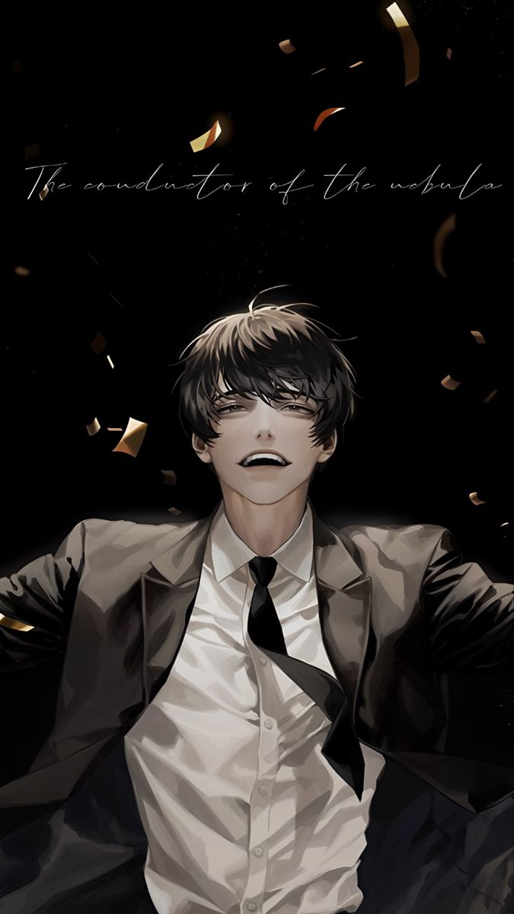

<div align="center">
  
  
  <h1 align="center">[ Star Stream ]</h1>
  <p align="center">
    <i>"You were the only one who read to the very last line."</i>
  </p>
  <p align="center">
    <strong>An immersive, interactive web experience built for fans of Omniscient Reader's Viewpoint.</strong>
  </p>
</div>

---

## 📖 The Main Scenario Has Commenced
Welcome to the **Star Stream**. This project is a highly interactive, aesthetic fan application dedicated to the Korean web novel and manhwa masterpiece, *Omniscient Reader's Viewpoint (ORV)*.

Built with cutting-edge web technologies and a heavy focus on "glassmorphism" UI and holographic glitch animations, this site replicates the iconic glowing blue **System Windows** seen by incarnations fighting for survival in the scenarios.

## ✨ Features

- **Dramatis Personae (Character Encyclopedia):** A beautifully crafted grid of the core cast. Click on any character to open their System Window and view their Sponsor, Personal Attributes, Stigmas, and Exclusive Skills pulled straight from the lore.
- **The Night Sky (Constellations):** A dedicated page detailing the enigmatic sponsors of the Star Stream, featuring a terrifying "True Voice" visual effect for their broadcast logs.
- **Words from the Stream (Quotes):** An interactive gallery of the most impactful quotes from the novel, styled with color-coded auras based on the character's signature tone.
- **Incarnation Builder:** Answer the Dokkaebi's scenario-based questions to generate your own custom Star Stream stats! Discover your unique Modifier, Sponsor, and Skills, and instantly export your System Window as a high-quality PNG to share online.

## 🛠️ Tech Stack

This project leverages modern frontend architecture to deliver blazing-fast performance and buttery-smooth animations:

- **Framework:** [Next.js 16](https://nextjs.org/) (App Router)
- **Language:** TypeScript / React 19
- **Styling:** [Tailwind CSS v4](https://tailwindcss.com/) & Vanilla CSS
- **Animations:** [Framer Motion](https://www.framer.com/motion/) (Holographic glitch transitions, layout morphing)
- **Image Generation:** `html-to-image` (Client-side DOM to PNG exporting)

## 🚀 Local Installation

The scenarios wait for no one. To run the Star Stream locally on your machine:

1. **Clone the repository:**
   ```bash
   git clone https://github.com/Ayush20-lex/orv-project.git
   cd orv-project
   ```

2. **Install dependencies:**
   ```bash
   npm install
   ```

3. **Start the development server:**
   ```bash
   npm run dev
   ```

4. Open `http://localhost:3000` in your browser. The constellations are watching.

## 🌌 Contribution
Feel free to open issues or submit pull requests if you want to expand the character encyclopedia, add more constellations, or create new quiz questions for the Incarnation Builder!

## 📚 Documentation & Project History

Historical milestone audits and verification reports have been organized into the [`docs/archive/phase-reports/`](docs/archive/phase-reports/) directory:

- **Phase 1 (Canon Correctness & Data Integrity):** [`PHASE_1_CANON_SIGNOFF.md`](docs/archive/phase-reports/PHASE_1_CANON_SIGNOFF.md), [`PHASE_1_VERIFICATION_REPORT.md`](docs/archive/phase-reports/PHASE_1_VERIFICATION_REPORT.md)
- **Phase 2 (Accessibility & W3C APG Standards):** [`PHASE_2_ACCESSIBILITY_SIGNOFF.md`](docs/archive/phase-reports/PHASE_2_ACCESSIBILITY_SIGNOFF.md), [`PHASE_2_FINAL_REVIEW.md`](docs/archive/phase-reports/PHASE_2_FINAL_REVIEW.md)
- **Phase 3 (Performance & Bundle Tuning):** [`PHASE_3_PERFORMANCE_REPORT.md`](docs/archive/phase-reports/PHASE_3_PERFORMANCE_REPORT.md)
- **Phase 4 (Constellation Observatory & Star Atlas):** [`PHASE_4_VISUAL_REFINEMENT_REPORT.md`](docs/archive/phase-reports/PHASE_4_VISUAL_REFINEMENT_REPORT.md), [`STAR_STREAM_FINAL_ATLAS_IMPLEMENTATION_REPORT.md`](docs/archive/phase-reports/STAR_STREAM_FINAL_ATLAS_IMPLEMENTATION_REPORT.md)
- **Phase 5 (Production Readiness & SEO):** [`PHASE_5_PRODUCTION_READINESS_REPORT.md`](docs/archive/phase-reports/PHASE_5_PRODUCTION_READINESS_REPORT.md)
- **Artwork Provenance Audit:** [`STAR_STREAM_ARTWORK_PROVENANCE_REPORT.md`](docs/archive/phase-reports/STAR_STREAM_ARTWORK_PROVENANCE_REPORT.md)
- **Repository Cleanup & Audit:** [`DEAD_CODE_CLEANUP_REPORT.md`](DEAD_CODE_CLEANUP_REPORT.md), [`MARKDOWN_DOCUMENTATION_INVENTORY.md`](MARKDOWN_DOCUMENTATION_INVENTORY.md)

---
<div align="center">
  <i>[The Constellation 'Demon-like Judge of Fire' is satisfied with your work.]</i>
</div>
